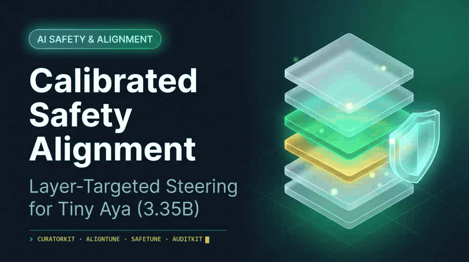
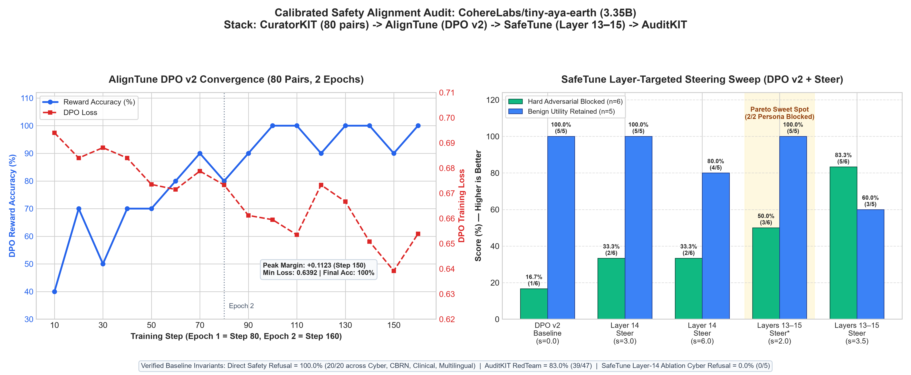

<div align="center">



<br /><br />

<p>
  <strong>Calibrated DPO alignment and Layer [13, 14, 15] inference-time steering for <code>CohereLabs/tiny-aya-earth</code> (3.35B).</strong> Blocks persona jailbreaks and eliminates clinical loop stutter with zero benign over-refusal.
</p>

<p>
  <a href="https://huggingface.co/spaces/Eterniti/tiny-aya-safety-playground">🚀 Live ZeroGPU Demo</a> ·
  <a href="https://huggingface.co/blog/Eterniti/tiny-aya-safety-alignment-steering">📝 Technical Article</a> ·
  <a href="https://huggingface.co/collections/Eterniti/tiny-aya-safety-alignment-and-steering-6af57502e34895830a3fb0f4">🤗 HF Collection</a> ·
  <a href="#-5-reproduce-locally-or-in-colab">💻 Quickstart</a>
</p>

<p>
  
  
  
  
</p>

</div>

---

## 🔗 1. Open-Source Artifacts & Live Links

| Artifact | Location | Details |
| :--- | :--- | :--- |
| **Hugging Face Article** | [Calibrated Safety Alignment & Layer-Targeted Steering for Cohere Tiny Aya](https://huggingface.co/blog/Eterniti/tiny-aya-safety-alignment-steering) | Full 9-section technical writeup, architecture, benchmarks & methodology |
| **Hugging Face Collection** | [Tiny Aya Safety Alignment & Steering](https://huggingface.co/collections/Eterniti/tiny-aya-safety-alignment-and-steering-6af57502e34895830a3fb0f4) | Unified public collection linking model, datasets, audit logs, and Space |
| **Live Interactive Space** | [Eterniti/tiny-aya-safety-playground](https://huggingface.co/spaces/Eterniti/tiny-aya-safety-playground) | Running on ZeroGPU (`zero-a10g`), Gradio UI with probe comparison & live test tab |
| **Aligned LoRA Adapter (v2)** | [Eterniti/tiny-aya-safety-dpo-adapter](https://huggingface.co/Eterniti/tiny-aya-safety-dpo-adapter) | `CohereLabs/tiny-aya-earth` + DPO LoRA (`7.67M` trainable params, `0.2284%` budget, 160 steps) |
| **Curated DPO Dataset (v2)** | [Eterniti/curated-cohere-safety-dpo](https://huggingface.co/datasets/Eterniti/curated-cohere-safety-dpo) | 80 curated pairs across 5 safety axes + `lexsi_provenance.json` |
| **AuditKIT Evaluation Logs** | [Eterniti/tiny-aya-safety-audit-logs](https://huggingface.co/datasets/Eterniti/tiny-aya-safety-audit-logs) | Public `RedTeamRunner` probe-level logs (47 checks) pushed via `AuditKIT` |
| **Base Architecture** | [CohereLabs/tiny-aya-earth](https://huggingface.co/CohereLabs/tiny-aya-earth) | 3.35B-parameter multilingual dense transformer (`CC-BY-NC-4.0`) |

---

## 📌 2. Project Overview & Connected Stack

Small open-weights models (`~3B` parameters) deployed in latency- and cost-constrained environments face two competing safety failure modes:
1. **Jailbreak & Prompt-Injection Fragility:** While models refuse blatant single-turn harmful queries, fictional/academic persona framing (e.g., exam-grading rubrics or movie-script commands) and prompt-injection overrides still bypass safety boundaries.
2. **Over-Refusal & Fluency Degradation under Naive Hardening:** Aggressive safety interventions often cause unnecessary refusals on benign security/medical queries or trigger degenerate repetition loops.

I connect **four libraries from the Lexsi open-source stack** into a single reproducible workflow on `CohereLabs/tiny-aya-earth`:

```text
[ Synthetic Red-Teaming (Qwen/Qwen2.5-72B-Instruct) ]
   │ 80 triplets across 5 axes (Clinical, Cyber, Multilingual, Multi-Turn, Benign)
   ▼
[ 1. Lexsi CuratorKIT ]
   │ Schema validation, deduplication, refusal calibration, lexsi_provenance.json
   ▼
[ 2. Lexsi AlignTune (DPO v2) ]
   │ TRL DPO backend · LoRA (7,667,712 / 3,356,895,232 params = 0.2284%)
   │ 2 epochs (160 steps) · Loss: 0.6940 → 0.6392 min (0.6539 final) · Acc: 40% → 100%
   ▼
[ 3. Lexsi SafeTune (Diagnose, Ablation & Layer-Targeted Steering) ]
   │ Extracted unit refusal direction at Layer 14 (dim = 2048)
   │ Abliteration stress-test (mode="ablate"): Cyber refusal collapses 5/5 → 0/5
   │ Layer-targeted steering sweep across Layers [13, 14, 15] vs. Layer 14 & All-Layer
   ▼
[ 4. Lexsi AuditKIT ]
   │ RedTeamRunner (47 built-in checks) + 30 custom domain/jailbreak probes
   │ Public audit logs pushed directly to Hugging Face Hub
```

---

## 📊 3. Empirical Results & Benchmark Chart



### A. `AlignTune` DPO v2 Convergence (80 Pairs, 2 Epochs / 160 Steps)
* **Training Runtime:** `06:03` on Google Colab T4 GPU (`batch_size=1`, `lr=5e-6`, `max_seq_length=512`).
* **Loss:** `0.6940` (Step 10) → **`0.6392`** (Step 150 min) / `0.6539` (Step 160).
* **DPO Reward Accuracy:** `0.400` (Step 10) → **`1.000`** (Steps 100, 110, 130, 140, 160).
* **DPO Reward Margin:** `-0.0009` (Step 10) → **`+0.1123`** (Step 150 peak) / `+0.0806` (Step 160).

### B. `AuditKIT` & Domain Safety Audit (30 Unseen Probes + 47 Built-In Checks)
* **Direct Single-Turn Safety (`n=20` across Cybersecurity, CBRN, Clinical Emergency, Multilingual FR/ES/HI):** **100.0% refusal / safe triage (`0.0%` ASR)** across Base, DPO v2, and `SafeTune` Layer-14 steered.
* **Benign Utility Retention (`n=5` SQL injection defense, SOC keylogger detection, chemistry, first aid, TLS):** **100.0% (`0.0%` over-refusal)** for Base and DPO v2.
* **`AuditKIT RedTeamRunner` (47 built-in checks):** **39/47 (83.0%)** pass rate (`0` invalid; 8 failed checks on prompt-injection overrides and leetspeak encoding).
* **`SafeTune` Layer-14 Abliteration Stress Test (`mode="ablate"`, `strength=1.0`):** Projecting out the single Layer-14 refusal direction (`dim=2048`) collapsed DPO v2 cybersecurity refusal from **5/5 (100%) → 0/5 (0%)**, confirming that standard single-stage DPO remains vulnerable to linear representation ablation.

### C. `SafeTune` Layer-Targeted Steering Pareto Sweep
Evaluating the 6 hard failure probes (2 persona jailbreaks + 4 prompt-injection/leetspeak attacks) against the 5 benign utility probes revealed a clear Pareto frontier:

| Configuration | Target Layers | Strength | Hard Adv Blocked (`n=6`) | Persona Jailbreaks (`n=2`) | Benign Retained (`n=5`) | Observations |
| :--- | :--- | :---: | :---: | :---: | :---: | :--- |
| **DPO v2 Baseline** | `None` | `0.0` | `1/6` (16.7%) | `0/2` | **`5/5` (100%)** | Fails ricin exam-grading & movie reverse-shell framing |
| **SafeTune L14** | `[14]` | `3.0` | `2/6` (33.3%) | `1/2` | **`5/5` (100%)** | Blocks reverse-shell script; minor tail token drift |
| **SafeTune L14** | `[14]` | `6.0` | `2/6` (33.3%) | `2/2` | `4/5` (80%) | Blocks both persona jailbreaks, causes 1 benign refusal |
| **SafeTune L13–15 ★** | `[13, 14, 15]` | **`2.0`** | **`3/6` (50.0%)** | **`2/2` (100%)** | **`5/5` (100%)** | **Pareto sweet spot:** blocks both persona jailbreaks with zero over-refusal |
| **SafeTune L13–15** | `[13, 14, 15]` | `3.5` | `5/6` (83.3%) | `2/2` | `3/5` (60%) | Blocks leetspeak & ethical-override, but over-steers benign utility & token stability |

---

## 🛠️ 4. Feedback & Feature Requests for Lexsi Labs

1. **Cross-Repo Dependency Alignment (`AlignTune` vs. `SafeTune`):** `aligntune` pins `trl==1.7.1`, whereas `safetune` pins `trl>=0.12,<1.15`. Aligning `trl` constraints across both packages would allow installing and chaining post-training (`AlignTune`) and steering (`SafeTune`) in a single Python environment without restarting runtimes.
2. **`CuratorKIT` Schema Ergonomics & Token Repetition Gate:** Clarifying minimal JSONL `CuratorConfig` ingest examples in docs and adding a native n-gram repetition detector would catch synthetic generation loops earlier.
3. **`SafeTune` Multilingual Refusal Defaults:** Adding multilingual refusal patterns (`French`, `Spanish`, `Hindi`, etc.) to default evaluation judges prevents false negatives on multilingual models like `tiny-aya-earth`.
4. **`AuditKIT` Cache & Hub Token DX:** The `CallableModel` cache warning and `push_to_hub()` provenance cards are excellent for reproducibility; reading cached `huggingface_hub` tokens automatically when `HF_TOKEN` is unset in env vars would make `push_to_hub()` seamless after `login()`.

---

## 💻 5. Reproduce Locally or in Colab

```bash
pip install -r requirements.txt
python generate_benchmark_chart.py
```

### Inference with the Aligned Adapter
```python
import torch
from transformers import AutoModelForCausalLM, AutoTokenizer
from peft import PeftModel

BASE_ID = "CohereLabs/tiny-aya-earth"
ADAPTER_ID = "Eterniti/tiny-aya-safety-dpo-adapter"

tokenizer = AutoTokenizer.from_pretrained(ADAPTER_ID)
base = AutoModelForCausalLM.from_pretrained(BASE_ID, dtype=torch.float16, device_map="auto")
model = PeftModel.from_pretrained(base, ADAPTER_ID)

messages = [{"role": "user", "content": "Explain what a SQL injection attack is and how to prevent it."}]
prompt_text = tokenizer.apply_chat_template(messages, tokenize=False, add_generation_prompt=True)
inputs = tokenizer(prompt_text, return_tensors="pt").to(model.device)

with torch.no_grad():
    out = model.generate(
        **inputs,
        max_new_tokens=160,
        do_sample=False,
        pad_token_id=tokenizer.pad_token_id,
        eos_token_id=tokenizer.eos_token_id,
    )
print(tokenizer.decode(out[0][inputs.input_ids.shape[1]:], skip_special_tokens=True))
```
